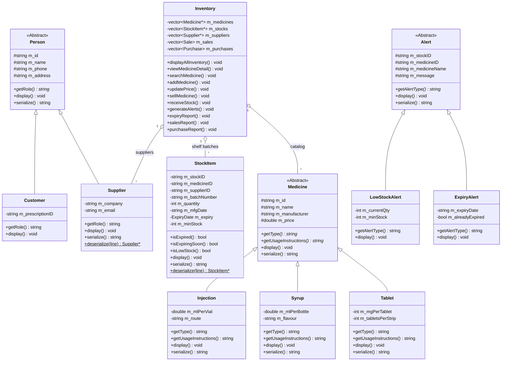

# Pharma Inventory Management System
> **Object-Oriented Programming (OOP) Laboratory Project / Assignment**  
> *Developed in C++ (C++11/C++14/C++17)*  
> *Architecture: 3-File Normalized Database System*

---

## 📋 Table of Contents
1. [Project Overview](#-project-overview)
2. [The 3-File Architecture](#-the-3-file-architecture)
3. [OOP Concepts Demonstrated](#-oop-concepts-demonstrated)
4. [Class Architecture & UML Diagram](#-class-architecture--uml-diagram)
5. [Key Features & Functional Modules](#-key-features--functional-modules)
6. [Data Persistence & File Formats](#-data-persistence--file-formats)
7. [Folder Structure](#-folder-structure)
8. [How to Run the Project](#-how-to-run-the-project)
9. [How the Desktop App Works with C++ (Viva Explanation)](#-how-the-desktop-application-works-with-c-viva-explanation)
10. [Sample Test Workflow for Lab Evaluation](#-sample-test-workflow-for-lab-evaluation)

---

## 🏥 Project Overview

The **Pharma Inventory Management System** is a modular C++ application designed for pharmacies and hospital dispensaries to manage drug catalogs, monitor physical shelf inventory across multiple batches, automate patient safety checks, and log financial transactions.

### Key Objectives & Safety Gates
- **Product vs. Physical Stock Separation**: Maintains a clear boundary between the **Medicine Catalog** (what the product is) and **Physical Inventory** (what physical batches are on shelves).
- **Patient Safety Gate**: Automatically intercepts and **blocks the sale of any expired medicine batch**.
- **Early Expiry & Low-Stock Alerts**: Categorizes medicines approaching expiry (< 3 months) or breaching minimum inventory thresholds.
- **Relational Consistency**: Connects medicines and suppliers via relational identifiers (`MedicineID`, `SupplierID`).

---

## 🗂 The 3-File Architecture

Unlike basic single-file projects where product data and stock counts are mixed together, this project adopts an **industry-standard 3-File Database Architecture**:

```
┌─────────────────────────┐       ┌─────────────────────────┐       ┌─────────────────────────┐
│  pharma_medicines.txt   │       │  pharma_inventory.txt   │       │  pharma_suppliers.txt   │
│    (Product Master)     │       │     (Physical Stock)    │       │   (Supplier Registry)   │
├─────────────────────────┤       ├─────────────────────────┤       ├─────────────────────────┤
│ • Medicine ID           │◄──┐   │ • Stock ID (STK001)     │   ┌──►│ • Supplier ID (SUP001)  │
│ • Name                  │   └───│ • Medicine ID (Link)    │   │   │ • Company Name          │
│ • Type (Tablet/Syrup...)│       │ • Supplier ID (Link)────┼───┘   │ • Contact Person        │
│ • Manufacturer          │       │ • Batch Number          │       │ • Phone & Email         │
│ • Base Price            │       │ • Current Quantity      │       │ • Address               │
│ • Dosage / Strength     │       │ • Mfg & Expiry Dates    │       └─────────────────────────┘
└─────────────────────────┘       │ • Min Stock Threshold   │
                                  └─────────────────────────┘
```

### Why this is superior:
1. **Multi-Batch Tracking**: A pharmacy can stock multiple batches of the same medicine (e.g. *Paracetamol*) received at different dates with different expiration dates.
2. **Single Responsibility Principle (SRP)**: Medicine specifications do not mutate when stock is dispensed.
3. **Database Normalization (3NF)**: Eliminates redundant data and demonstrates practical database design within an OOP paradigm.

---

## 🧬 OOP Concepts Demonstrated

| OOP Concept | Implementation in Code | Real-World Purpose |
| :--- | :--- | :--- |
| **Classes & Objects** | `Medicine`, `StockItem`, `Supplier`, `Customer`, `Alert`, `Inventory`, `Sale`, `Purchase` | Models real entities with encapsulated state and behaviors. |
| **Encapsulation & Data Hiding** | Private attributes with validated accessors (`setQuantity()`, `setPrice()`, `isExpired()`) | Prevents invalid state mutations and preserves stock integrity. |
| **Inheritance Hierarchy** | • `Person` ➔ `Supplier`, `Customer`<br>• `Medicine` ➔ `Tablet`, `Syrup`, `Injection`<br>• `Alert` ➔ `ExpiryAlert`, `LowStockAlert` | Promotes code reuse and defines clear domain specialization. |
| **Polymorphism & Dynamic Dispatch** | Base-class pointers: `vector<Medicine*>`, `vector<Alert*>`, `vector<Supplier*>` | Enables uniform manipulation of specialized derived types at runtime. |
| **Pure Virtual Functions (`= 0`)** | `Medicine::getType()`, `Medicine::getUsageInstructions()`, `Person::getRole()`, `Alert::getAlertType()` | Defines abstract contracts that subclasses are required to implement. |
| **Virtual Destructors** | `virtual ~Medicine()`, `virtual ~Person()`, `virtual ~Alert()` | Prevents resource leaks when deleting derived objects via base pointers. |
| **File Persistence & Serialization** | `serialize()`, `deserialize()`, stream I/O (`ifstream`, `ofstream`) | Maintains database state across program executions. |

---

## 🏛 Class Architecture & UML Diagram



---

## ⚡ Key Features & Functional Modules

### 1. Physical Inventory Management (`pharma_inventory.txt`)
- **Real-Time Stock Ledger**: Displays stock ID, medicine name, batch number, remaining quantity, price, expiry date, and status flags:
  - 🟢 **OK**: Safe quantity and valid expiry date.
  - 🟡 **EXP. SOON**: Batch expiring within 3 months.
  - 🟡 **LOW STOCK**: Current units $\le$ minimum reorder threshold.
  - 🔴 **EXPIRED**: Shelf life has passed.
- **Detailed Inspection**: Correlates the product master formulation (mg, volume, route) with all active batches on physical shelves.

### 2. Transaction Processing & Patient Safety
- **Dispense / Sell Medicine**:
  - Allows selecting specific batch or automatically finds available stock.
  - **Safety Gate**: Immediately blocks the transaction if the batch is expired.
  - Decrements physical stock and logs itemized sale to `pharma_sales.txt`.
- **Receive Stock / Procurement**:
  - Restocks existing inventory batches or registers newly arrived batches.
  - Records unit acquisition costs and logs to `pharma_purchases.txt`.

### 3. Supplier Registry (`pharma_suppliers.txt`)
- Directory of verified pharmaceutical suppliers and distributors with contact and company information.

### 4. Audits & Reports
- **Expiry Audit Report**: Identifies batches requiring removal or quarantine.
- **Sales & Purchase Reports**: Summarizes total revenue and procurement expenditure.
- **Automated Safety Alerts (`pharma_alerts.txt`)**: Exports low-stock and expiry warnings to file.

---

## 💾 Data Persistence & File Formats

All primary data is stored in pipe-delimited (`|`) text files:

| File Name | Role | Data Schema |
| :--- | :--- | :--- |
| `pharma_medicines.txt` | Product Master Catalog | `Type\|MedicineID\|Name\|Manufacturer\|Price\|[Type-Fields]` |
| `pharma_inventory.txt` | Physical Stock Ledger | `StockID\|MedicineID\|SupplierID\|Batch\|Quantity\|MfgDate\|Expiry\|MinStock` |
| `pharma_suppliers.txt` | Supplier Registry | `SupplierID\|Name\|Phone\|Address\|Company\|Email` |
| `pharma_sales.txt` | Sales Billing Log | `SaleID\|StockID\|MedicineID\|MedicineName\|CustomerName\|Quantity\|PriceEach\|Date` |
| `pharma_purchases.txt` | Purchase Ledger | `PurchaseID\|StockID\|MedicineID\|MedicineName\|SupplierID\|Quantity\|CostEach\|Date` |
| `pharma_alerts.txt` | Audit Safety Alerts | `AlertType\|StockID\|MedicineID\|MedicineName\|Message` |

---

## 📂 Folder Structure

```text
PharmaCare-Inventory-System/
├── main.cpp                   # Complete C++ OOP Source Code (with CLI API modes)
├── main.exe                   # Compiled Native C++ Binary (MinGW GCC)
├── desktop_app.js             # Lightweight Desktop Bridge (invokes main.exe directly)
├── Run_Desktop_App.bat        # 1-Click Launcher for Windows Desktop Application
├── Run_Console_App.bat        # 1-Click Launcher for Classic Terminal Menu
│
├── desktop_ui/                # Windows Desktop GUI
│   ├── index.html             # Clean Medical White & Emerald Green Layout (SVG Icons)
│   ├── style.css              # Responsive Styles, Badges, Modals, C++ Console Bar
│   └── client.js              # Client Controller calling main.exe via bridge
│
├── pharma_medicines.txt       # Primary Database: Catalog Master (Tablet, Syrup, Injection)
├── pharma_inventory.txt       # Primary Database: Shelf Batches (StockItem)
├── pharma_suppliers.txt       # Primary Database: Supplier Directory
├── pharma_sales.txt           # Ledger: Billing and Dispensing History
├── pharma_alerts.txt          # Ledger: Audit Safety Alerts
├── .gitignore                 # Git ignore rules for IDE & OS files
└── README.md                  # Complete Documentation & Viva Guide
```

---

## 🚀 How to Run the Project

### Option A: Windows Desktop Application (GUI Mode) — **RECOMMENDED**
Simply double-click:
```text
Run_Desktop_App.bat
```
*Or via terminal:*
```powershell
node desktop_app.js
```
- A native, frameless Windows desktop window pops up.
- **Every button click invokes `main.exe` directly** in the background.
- Notice the **Live C++ Engine Call** bar at the bottom: whenever you view stock, dispense medicine, or receive supplies, it prints the exact command executed on `main.exe` (e.g. `.\main.exe --api-stock`, `.\main.exe --api-sell ...`).

---

### Option B: Interactive Terminal Menu (CLI Mode)
Double-click:
```text
Run_Console_App.bat
```
*Or via terminal:*
```powershell
.\main.exe
```
Provides the full interactive terminal menu with numeric options `[1]` to `[15]`.

---

## 💡 How the Desktop Application Works with C++ (Viva Explanation)

If your teacher or lab examiner asks:  
> *"Is this just a website/frontend, or is it actually running your C++ code?"*

Here is the exact explanation you should give:
1. **The C++ binary (`main.exe`) is the sole brain and backend**:
   - All classes (`Medicine`, `Tablet`, `Syrup`, `StockItem`, `Supplier`, `Inventory`) are written and compiled in C++.
   - All business logic, stock decrements, and file updates (`pharma_inventory.txt`, `pharma_sales.txt`) happen inside C++ file streams (`ifstream`/`ofstream`).
2. **Patient Safety Gate is hardcoded in C++**:
   - If a batch is expired, the C++ `isExpired()` method in `StockItem` returns `true` and the C++ engine actively rejects the sale with exit code and error message.
3. **The Desktop UI is just the presentation window**:
   - Built with HTML, CSS, and JavaScript to look like a modern clinical pharmacy software.
   - It communicates with `desktop_app.js`, which uses Node.js `execFile` to launch `main.exe --api-...`.
   - The UI displays the live C++ command executed at the bottom of the screen, so you can visibly show the evaluator that `main.exe` is being called in real-time.

---

## 🧪 Sample Test Workflow for Lab Evaluation

1. **Test Patient Safety Gate (Expired Batch Blocked)**:
   - Go to **Dispense Medicine** tab in the desktop app (or option `[7]` in terminal).
   - Select `STK005` (Batch `CS501`, Ciprofloxacin Eye Drops, expired 02/2025).
   - Notice the system locks the sale with a red warning: *"Patient safety gate active: batch is expired"*.
   - If forced, `main.exe` returns: `PATIENT SAFETY BLOCK: Batch CS501 has EXPIRED! Sale rejected.`
2. **Test Successful Dispense**:
   - Select `STK001` (Paracetamol 500mg, Batch `P101`, valid until 12/2026).
   - Enter Customer name: `Alice` and Quantity: `2`.
   - Click **Execute Sale in C++ Engine**.
   - `main.exe` deducts 2 units from `pharma_inventory.txt` and logs the invoice into `pharma_sales.txt`.
3. **Test Polymorphic Formulation Hierarchy**:
   - Go to **Medicine Catalog** tab.
   - Inspect Tablets (`dosageMg`, `packSize`), Syrups (`volumeMl`, `sugarFree`), and Injections (`volumeMl`, `route`).
   - *Demonstrates: Derived class virtual method overriding.*
4. **Test Stock Restock**:
   - Go to **Receive Stock** tab.
   - Enter new batch details. C++ creates a new `StockItem` instance, assigns an auto-generated `StockID` (e.g. `STK008`), and persists it to `pharma_inventory.txt`.
