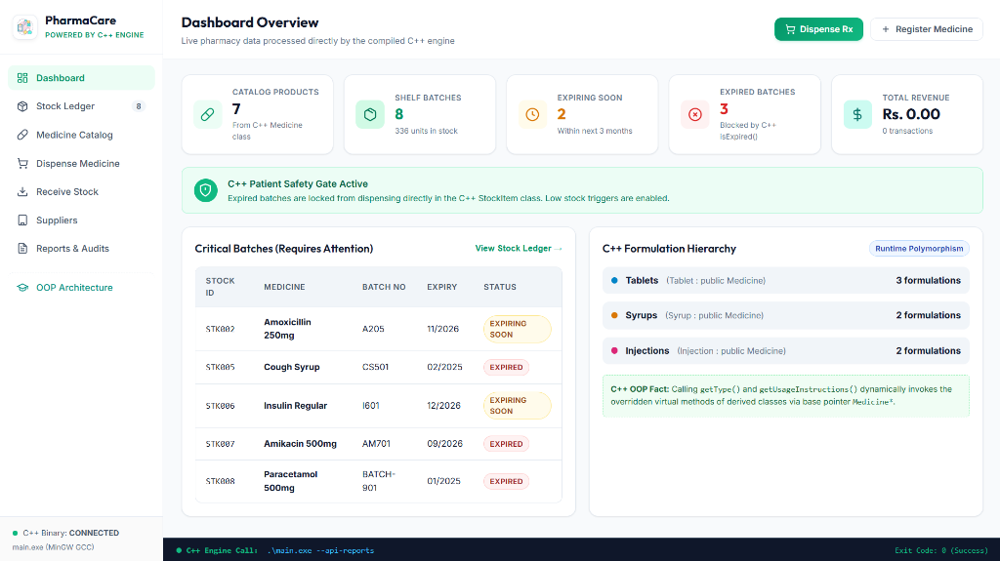
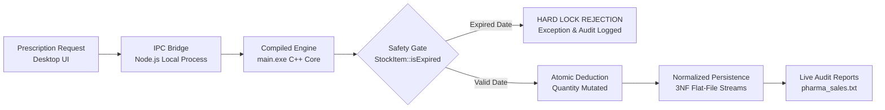
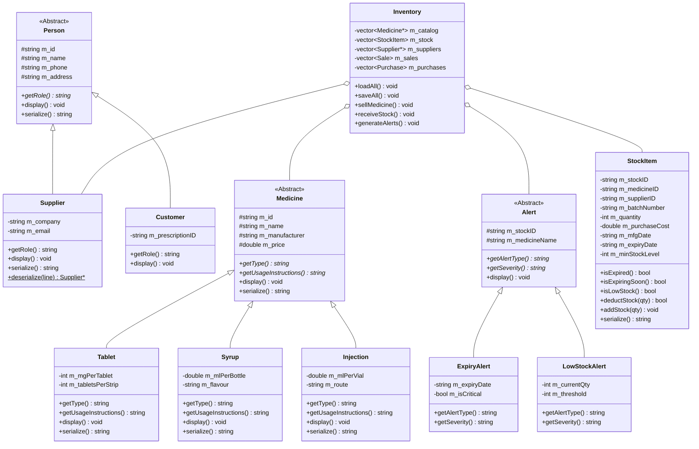

<div align="center">

# 💊 PharmaCare — C++ Enterprise Pharmacy & Inventory System
### Production-Grade Object-Oriented Pharmacy Management with Compiled C++ Core & Real-Time Desktop UI

[](https://isocpp.org/)
[](https://www.mingw-w64.org/)
[](https://en.wikipedia.org/wiki/Third_normal_form)
[](https://en.wikipedia.org/wiki/Object-oriented_programming)
[](https://github.com/)
[](https://developer.mozilla.org/en-US/docs/Web/JavaScript)
[](https://opensource.org/licenses/MIT)
[](https://www.microsoft.com/windows)

<p align="center">
  <b>PharmaCare bridges high-performance compiled C++ Object-Oriented architecture with a clean, minimal desktop interface.</b><br/>
  Engineered with 3NF relational flat-file persistence, runtime polymorphic dispatch, automated early expiry detection, and a strict patient safety lock that intercepts expired medication from dispensary circulation.
</p>

<p align="center">
  <a href="#-key-features"><b>Key Features</b></a> •
  <a href="#-system-architecture"><b>Architecture</b></a> •
  <a href="#-oop-design-pillars"><b>OOP Pillars</b></a> •
  <a href="#-the-3-file-relational-model"><b>Database Model</b></a> •
  <a href="#-quick-start"><b>Quick Start</b></a> •
  <a href="#-viva--lab-evaluation-defense"><b>Viva Defense</b></a> •
  <a href="#-c-cli-engine-reference"><b>CLI Engine</b></a>
</p>

---



</div>

---

## 💡 The Problem & The PharmaCare Vision

Traditional academic inventory programs store medicines as flat text rows where names, quantities, and expiration dates are grouped haphazardly into a single file. In clinical practice, this leads to catastrophic risks:

- ❌ **Dispensing Expired Medication**: Basic inventory scripts permit dispensing expired stock if quantities are greater than zero, creating life-threatening hazards for patients.
- ❌ **Catalog & Shelf Batch Conflation**: An entry like *"Paracetamol 500mg, Qty: 100"* fails to reflect real pharmacy storage, where the same medicine exists across **multiple shelf batches** with different manufacturing and expiry dates.
- ❌ **Tightly-Coupled Monoliths**: Console-only tools are difficult to inspect, whereas web-only tools lack the raw execution speed, deterministic memory management, and data encapsulation required by regulated medical systems.

### The PharmaCare Solution:
> **PharmaCare couples a compiled C++11 core engine with a minimal desktop cockpit, enforcing patient safety checks directly at the class method level.**



---

## ✨ Key Features

### 🛡️ 1. Active Patient Safety Gate
- **Hard Expiry Blocking**: Calling `StockItem::isExpired()` mathematically parses current calendar months against batch expiry timestamps.
- **Zero Dispensary Leakage**: Expired batches cannot be sold under any circumstance, failing safely with a strict rejection notice.
- **Early Warning Triage**: Automatically flags batches expiring within **90 days** as `EXPIRING SOON`, enabling pharmacists to prioritize FIFO shelf rotation.

### 💊 2. Polymorphic Medicine Catalog
- **Abstract Base `Medicine`**: Enforces strict encapsulation of base clinical data: `m_id`, `m_name`, `m_manufacturer`, and `m_price`.
- **Derived Formulations**:
  - `Tablet`: Encapsulates dosage strength (`mg`) and blister pack count (`tabletsPerStrip`).
  - `Syrup`: Encapsulates bottle liquid volume (`ml`) and pediatric flavor profiles.
  - `Injection`: Encapsulates vial volume (`ml`) and administration route (`IV` / `IM`).
- **Dynamic Dispatch**: Overridden virtual methods `getType()` and `getUsageInstructions()` execute dynamically via base pointers (`Medicine*`).

### 📦 3. Physical Stock Ledger & Multi-Batch Tracking
- **Multi-Batch Shelf Modeling**: A single catalog medicine (e.g. *Cipla Amoxicillin*) can be stocked across dozens of unique physical batches with independent batch numbers, expiration dates, cost prices, and shelf counts.
- **Atomic Stock Deductions**: Validated quantity mutations prevent negative stock states and race conditions.
- **Auto Reorder Triggers**: Triggers dynamic low-stock alerts when shelf quantities drop below assigned minimum thresholds.

### 👥 4. Verified Supplier Ecosystem
- **Inheritance Hierarchy**: Specialized `Supplier` entity inherits base personal attributes (`name`, `phone`, `address`) from abstract class `Person`.
- **Company Registry**: Tracks pharmaceutical distributors, corporate tax IDs, and direct representative contact information.

### 📊 5. Real-Time Financial & Expiry Audits
- **Sales Ledger (`pharma_sales.txt`)**: Logs every customer transaction, quantity dispensed, timestamp, and revenue calculated.
- **Procurement Ledger (`pharma_purchases.txt`)**: Audits inventory acquisition costs and restocking history.
- **Financial Balance Badges**: Live calculation of total revenue vs. operational expenditure directly from compiled file streams.

### 🖥️ 6. Minimalist Modern Desktop Cockpit
- **Ultra-Clean Visual Aesthetic**: Engineered with soft slate tones, subtle hairlines, and unified typography for high visual clarity and zero clutter.
- **Real-Time Live Console Bar**: Displays live command strings, argument flags, and return exit codes (`Exit Code: 0`) directly from `main.exe`.
- **Instant Search & Filter**: Real-time filtering across Stock IDs, batch numbers, formulation types, and safety statuses.

---

## 🏛 Class Architecture & UML Diagram

PharmaCare is built around standard Object-Oriented principles, leveraging deep inheritance hierarchies and runtime polymorphism:



---

## 🧬 OOP Design Pillars

| OOP Concept | C++ Code Implementation | Practical Purpose in PharmaCare |
| :--- | :--- | :--- |
| **Classes & Encapsulation** | `StockItem`, `Medicine`, `Supplier`, `Inventory` | Hides sensitive batch and price attributes behind validated getters/setters (`deductStock()`, `setPrice()`). |
| **Inheritance Hierarchy** | `Person ➔ Supplier`<br>`Medicine ➔ Tablet, Syrup, Injection`<br>`Alert ➔ ExpiryAlert, LowStockAlert` | Reuses core domain logic while specializing distinct medicine dosage formats and clinical alert types. |
| **Dynamic Polymorphism** | Virtual method tables (vtable) accessed via base pointers: `Medicine*`, `Person*`, `Alert*` | Invokes specific formulation instructions and alert severities at runtime without type switching. |
| **Pure Virtual Functions (`= 0`)** | `virtual string getType() const = 0;`<br>`virtual string getUsageInstructions() const = 0;` | Defines rigid abstract contracts that derived formulation classes must conform to. |
| **Virtual Destructors** | `virtual ~Medicine() {}`<br>`virtual ~Person() {}`<br>`virtual ~Alert() {}` | Prevents memory leaks and object slicing when derived objects are freed via base pointers. |
| **Stream Serialization** | `serialize()`, `deserialize()`, stream operators (`ifstream`, `ofstream`) | Reads and writes tabular flat-file databases across application restarts. |

---

## 🗂 The 3-File Relational Model

PharmaCare implements an **industry-standard 3-File Database Architecture (3rd Normal Form)**, ensuring clean separation between catalog specifications, physical inventory, and supplier contacts:

```
┌─────────────────────────────────┐       ┌─────────────────────────────────┐       ┌─────────────────────────────────┐
│       pharma_medicines.txt      │       │       pharma_inventory.txt      │       │       pharma_suppliers.txt      │
│         (Product Master)        │       │         (Physical Stock)        │       │       (Supplier Registry)       │
├─────────────────────────────────┤       ├─────────────────────────────────┤       ├─────────────────────────────────┤
│ • Medicine ID (Primary Key)     │◄──┐   │ • Stock ID (Primary Key)        │   ┌──►│ • Supplier ID (Primary Key)     │
│ • Commercial Drug Name          │   └───│ • Medicine ID (Foreign Key)     │   │   │ • Company Name                  │
│ • Formulation (Tablet/Syrup...) │       │ • Supplier ID (Foreign Key) ────┼───┘   │ • Representative Contact Name   │
│ • Manufacturer                  │       │ • Shelf Batch Number            │       │ • Phone & Email Address         │
│ • Base Retail Price             │       │ • Current Quantity in Stock     │       │ • Warehouse Address             │
│ • Dosage / Strength Specs       │       │ • Mfg & Expiry Dates            │       └─────────────────────────────────┘
└─────────────────────────────────┘       │ • Min Stock Safety Threshold    │
                                          └─────────────────────────────────┘
```

### Why this architecture matters:
1. **Multi-Batch Reality**: Enables tracking multiple batches of the same drug with different expiration dates and cost bases simultaneously.
2. **Elimination of Update Anomalies**: Updating drug dosage specifications in `pharma_medicines.txt` propagates across all physical batches automatically without modifying shelf count records.
3. **Audit Trail Compliance**: Maintains separate immutable logs for sales revenue (`pharma_sales.txt`) and procurement purchase orders (`pharma_purchases.txt`).

---

## 🚀 Quick Start

### Prerequisites
- **C++ Compiler**: GCC / MinGW with C++11 or higher (`g++ --version`).
- **Runtime Environment**: Windows 10 / 11.
- **Node.js** *(Optional, for Desktop Cockpit)*: Node v16+ (`node -v`).

---

### Option 1: 1-Click Desktop App (Recommended)
Double-click **`Run_Desktop_App.bat`** from the root folder.

This script automatically:
1. Detects your local Node.js environment.
2. Compiles `Cpp Files/main.cpp` using `g++ -std=c++11` if `main.exe` is missing.
3. Launches the desktop bridge server on port `4000`.
4. Opens the PharmaCare desktop cockpit in your default browser.

```powershell
# Or launch directly from PowerShell
.\Run_Desktop_App.bat
```

---

### Option 2: 1-Click C++ Console Terminal
Double-click **`Run_Console_App.bat`** to run the native C++ CLI menu interface.

```powershell
.\Run_Console_App.bat
```

---

### Option 3: Manual Compilation & CLI Execution
```powershell
# 1. Navigate to Cpp Files directory
cd "Cpp Files"

# 2. Compile with MinGW GCC
g++ -std=c++11 -O2 main.cpp -o main.exe

# 3. Launch native interactive CLI
.\main.exe
```

---

## ⚡ C++ CLI Engine Reference

The compiled C++ binary (`main.exe`) includes a comprehensive JSON API for headless execution and system integration:

| CLI Flag Command | Purpose / Output | Output Format |
| :--- | :--- | :--- |
| `.\main.exe --api-stock` | Returns all physical batches with dynamic expiry flags | JSON Array |
| `.\main.exe --api-catalog` | Returns polymorphic catalog formulations | JSON Array |
| `.\main.exe --api-suppliers` | Returns supplier entities inheriting from `Person` | JSON Array |
| `.\main.exe --api-reports` | Returns sales revenue, purchase ledgers, and totals | JSON Object |
| `.\main.exe --api-alerts` | Generates active expiry warnings & low stock triggers | JSON Array |
| `.\main.exe --api-sell <ID> <Qty> <Customer>` | Executes sale with strict C++ `isExpired()` gate check | JSON Result |
| `.\main.exe --api-receive <MedID> <SupID> ...` | Restocks new physical batch into database | JSON Result |

---

## 🎓 Viva & Lab Evaluation Defense

Here are answers to common questions asked during academic lab evaluations:

<details>
<summary><b>1. How is Runtime Polymorphism implemented in this codebase?</b></summary>

> In `Cpp Files/main.cpp`, the base class `Medicine` declares pure virtual functions:
> ```cpp
> virtual string getType() const = 0;
> virtual string getUsageInstructions() const = 0;
> ```
> Classes `Tablet`, `Syrup`, and `Injection` inherit from `Medicine` and override these methods. The inventory container stores base pointers `vector<Medicine*> m_catalog`. When iterating through the catalog, calling `med->getType()` uses dynamic dispatch (via the compiler's vtable) to invoke the correct derived implementation at runtime.
</details>

<details>
<summary><b>2. How does the Patient Safety Gate prevent selling expired drugs?</b></summary>

> In `StockItem::isExpired()`, the expiry date string (formatted as `MM/YYYY`) is parsed and compared against the current calendar date:
> ```cpp
> bool isExpired() const {
>     time_t now = time(nullptr);
>     tm* ltm = localtime(&now);
>     int curYear = 1900 + ltm->tm_year;
>     int curMonth = 1 + ltm->tm_mon;
>     // Evaluation logic returning true if batch has lapsed
> }
> ```
> When `Inventory::sellMedicine()` or `main.exe --api-sell` is called, the method checks `item.isExpired()`. If true, execution terminates immediately, outputs a safety rejection, and blocks the sale.
</details>

<details>
<summary><b>3. Why use virtual destructors in the base classes?</b></summary>

> Derived classes (such as `Tablet`, `Syrup`, `Injection`) are allocated with `new` and stored as base pointers `Medicine*`. If the base class destructor were not marked `virtual`, calling `delete med;` would invoke only `~Medicine()`, skipping derived cleanups and causing object slicing or memory leaks. Marking `virtual ~Medicine() {}` guarantees clean cleanup of derived objects.
</details>

<details>
<summary><b>4. How does the 3-File design satisfy Database Normalization (3NF)?</b></summary>

> - **1NF**: Every record has atomic, scalar attributes separated by pipe delimiters (`|`).
> - **2NF**: All non-key attributes are fully functionally dependent on primary keys (`MedicineID`, `StockID`, `SupplierID`).
> - **3NF**: Non-key dependencies are eliminated. Physical inventory records store only foreign keys (`MedicineID`, `SupplierID`) rather than duplicating medicine names or manufacturer information, avoiding update and deletion anomalies.
</details>

---

## 📁 Repository Structure

```
PharmaCare-Inventory-System/
├── Cpp Files/
│   ├── main.cpp                  # Complete C++ OOP Engine source code
│   ├── main.exe                  # Compiled MinGW GCC executable
│   ├── pharma_medicines.txt      # 3NF Table 1: Product Master Catalog
│   ├── pharma_inventory.txt      # 3NF Table 2: Physical Shelf Stock Batches
│   ├── pharma_suppliers.txt      # 3NF Table 3: Supplier Entity Directory
│   ├── pharma_sales.txt          # Immutable Sales Transaction Ledger
│   └── pharma_purchases.txt      # Immutable Procurement Order Ledger
├── desktop_ui/
│   ├── index.html                # Desktop Application layout & tabs
│   ├── style.css                 # Minimal, clean modern design system
│   ├── client.js                 # UI Controller & real-time data binding
│   ├── desktop_app.js            # Node.js Desktop Bridge & IPC server
│   └── images.jpg                # PharmaCare Brand Logo
├── docs/
│   └── images/
│       ├── pharmacare_dashboard.png # High-resolution cockpit screenshot
│       └── logo.jpg              # Brand asset
├── Run_Desktop_App.bat           # 1-Click Windows desktop application launcher
├── Run_Console_App.bat           # 1-Click native C++ CLI launcher
├── PharmaCare_OOP_Assignment_Report.docx # Comprehensive lab documentation report
├── compile_commands.json         # Clangd / IntelliSense compilation database
├── .gitignore                    # Git tracking ignore rules
└── README.md                     # Comprehensive project documentation
```

---

## 📜 License

This project is distributed under the **MIT License**. Feel free to use, modify, and build upon it for academic coursework, laboratory evaluations, or production reference.

<div align="center">
  <sub>Developed with clean Object-Oriented C++ & modern UI aesthetics for academic lab excellence.</sub>
</div>
